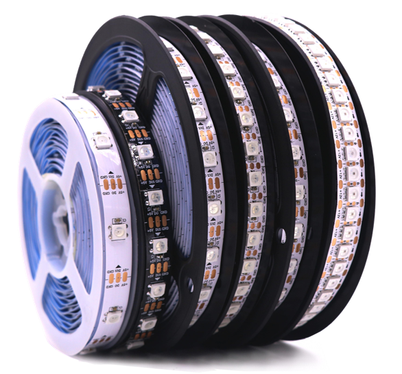
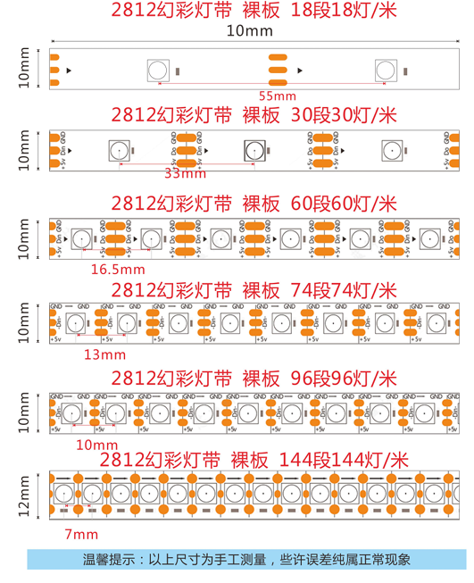
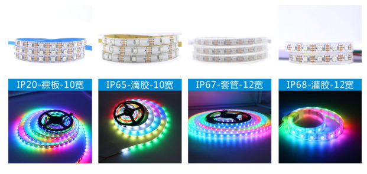
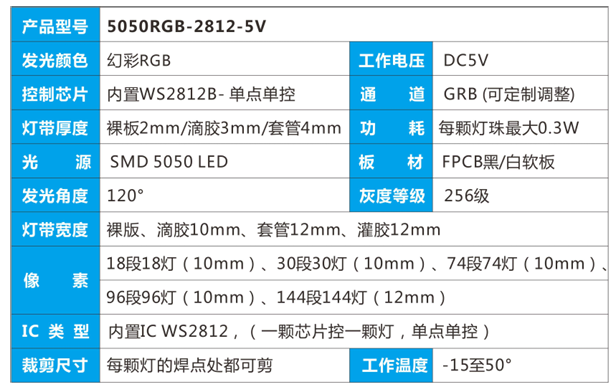
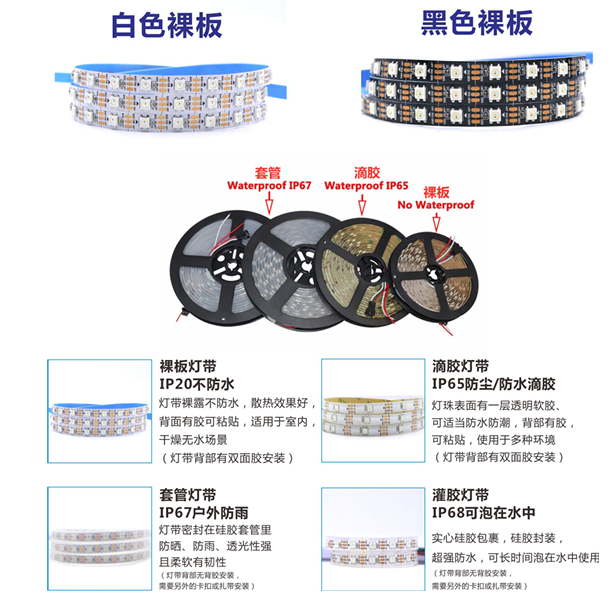
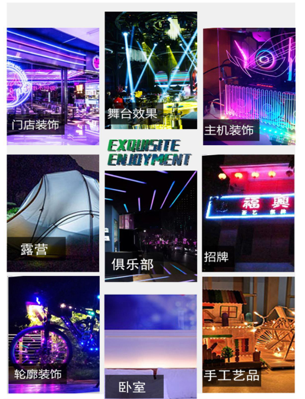
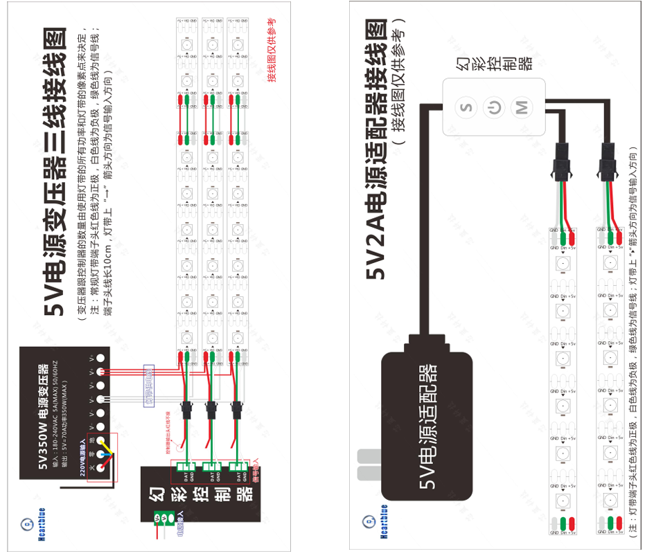
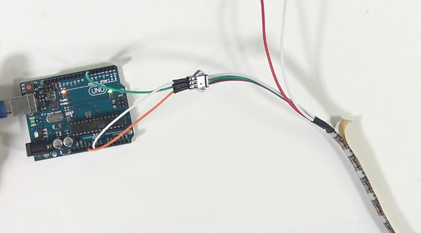

# DC5V-WS2812幻彩低压灯带

1. 采用优质高亮LED发光二极管发光，具有耗电小(每颗灯珠≤0.3W)、产生热量小、无眩光， 寿命长、耐冲击等特点，低电压直流5V供电，安全可靠性高。 
2. 颜色纯正柔和绚丽而且丰富多彩，有红黄蓝绿白七彩，还可按要求定制各种颜色或变换， 可根据控制器调整全彩效果：跑马，流水，呼吸，渐变等幻彩效果。 
3.  寿命长，平均寿命达5万小时。 
4. 单点单控，一颗芯片控一颗灯珠，可以沿着焊盘上面切线任意截断，不损坏其它部分，又 可无限度接长，可按客户要求定制各种长度的灯条。 
5. 采用非常柔软的PCB板为基板，可随意对接，弯曲，裁剪及任意固定在凹凸表面。 
6. 产品轻、薄，适合在窄小的空间里面安装。 
7. 由印制电路板组成，背面带双面胶，用于粘贴附著于固定物上。

1、室内使用：LED灯带用于室内装饰时，由于不必经受风吹雨打，所以安装就非常简单。以生产的LED灯带为 例，每款LED灯带的背后都贴有自粘性3M双面胶，安装时可以直接撕去3M双面胶表面的贴纸，然后把灯条 固定在需要安装的地方，用手按平就好了。至于有的地方需要转角或者是长了怎么办？很简单，LED灯带是 以单点单控的串并联方式组成的电路结构，每1颗LED即可以剪断单独使用。 

2、户外使用：户外安装由于会经受风吹雨淋，如果采用3M胶固定的话，时间一久就会造成3M胶粘性降低而致 使LED灯带脱落，因此户外安装常采用卡槽固定的方式，需要剪切和连接的地方，方法和室内安装一样，只 是需要另外配备防水胶，以巩固连接点的防水效果。

**LED 灯带使用范围**

广泛用于勾画具有标志性的建筑物大厦楼阁，桥梁，公园广场等轮廓的亮化工程，更成为点缀酒店，网吧， KTV, 洗浴中心，迪厅，夜总会等高档娱乐场所的靓丽风景线。鉴于其亮度高，柔韧性好，可塑性强，色彩绚丽 变化多样，个人DIY家居装饰，橱窗，时装表演，路径指示均可将之作为首选。

**安装方法与注意事项**

3、 电源连接方法：LED灯带一般电压为直流5V，因此需要使用5V电源适配器供电，电源的 大小根据LED灯带的功率和连接长度来定。如果不希望每条LED灯带都用一个电源来控制，可以购 买一个功率比较大的5V变压器做总电源，然后把所有的LED灯带输入电源全部并联起来（线材尺 寸不够的话可以另外延长），统一由总开关电源供电。这样的好处是可以集中控制，不方便的地方 是不能实现单个LED灯带的点亮效果和开关控制，具体采用哪种方式可以由自己去衡量。 

4、 控制器连接方式：LED跑马灯带和RGB全彩灯带需要使用控制器来实现变幻效果，而 每个控制器的控制距离不一样，一般而言，简易控制器的控制距离为5到10米，遥控控制器的控 制距离为10到15米，最长可以控制到20米距离。如果LED灯带的连接距离较长，而控制器不能 控制那么长的灯带，那么就需要使用功率放大器来进行分接。

5、 注意LED灯带的连接距离：一般来说，5050系列的LED灯带，最长连接距离为15米。 如果超出了这个连接距离，则LED灯带很容易发热，使用过程中会影响LED灯带的使用寿命。因此， 安装的时候一定要按照厂家的要求进行安装，切忌让LED灯带过负荷运行。

**LED 灯带与UNO开发板接线方式说明**

接线方式：灯带的5V/电源正极，接到UNO开发板5V引脚。灯带的GND/电源负极，接到UNO开发板的GND引脚。灯带的DIN/数据输入引脚，接到UNO开发板的D6引脚。

由于生产批次可能调整线序，不能只凭线色通电。连接前必须核对焊盘丝印、箭头方向和实物标识；数据不能从 DOUT 端反向输入。

**LED 灯带采购注意事项**

现在有很多客户需求的LED灯带都不是常规规格，是需要定制的。但是因为不熟悉LED灯带的 一些技术参数，因此有很多要求是明显的不符合技术要求，就算做出来其使用也会受到影响。这里 特别谈一下关于LED灯带特殊定制的三大注意事项，以供采购朋友们参考：

1、LED 灯带的电路设计：

LED 灯带的电路包括串联电路和并联电路，还有就是串并联电路。 串联电路的优点是电流恒定，比较容易控制LED的驱动电流。缺点是如果其中一个LED损坏， 则所有的LED都会不亮，但不会影响其他LED的寿命。 并联电路的优点是任何一个LED坏了都不影响其他LED的使用。缺点是如果不加限流电阻的话， 任何一个LED有损坏，就会造成其他的LED两端电流加大，会烧坏其他LED。并且因为单个LED的 驱动电压很低，会造成大部分的电压做无用功，对于资源也是一种浪费。 串并联电路是目前LED灯带通用的电路，因为采用几个LED一起串联组成一组，再和其他组进 行并联。可以最大限度的提高对供电电压的使用率，减少无用功损耗。同时，采用几个LED串联， 可以保证这几个LED的驱动电流是一致的，有利于恒定LED的电流，以确保LED的使用寿命。

2、LED灯带每米的灯珠数量：

通常情况下，LED灯带每米的灯珠数量是固定的。2812的灯珠常规是30灯/60灯/74灯/96灯/ 144 灯/米。如果有其他特殊要求的，通常是1个LED一组，如需每米50灯，这就涉及到要修 改电路。所以，在做特殊要求定制的LED灯带的时候，需先跟销售人员确认内容。 

3、LED 灯带的剪切位置：灯带为一颗灯珠做一个回路，单点单控，所以灯带可以一灯一剪。

